# Step-by-Step Guide to Securing Endpoints with Wazuh SIEM: Deployment, Monitoring, and Microsoft…

📝 Originally published on [Medium](https://medium.com/@aabiodunadeleke/step-by-step-guide-to-securing-endpoints-with-wazuh-siem-deployment-monitoring-and-microsoft-a55ad663b7fb) · 2024-11-26

---

In today’s rapidly evolving cybersecurity landscape, robust tools are essential to monitor and protect systems against potential threats. **Wazuh** is a powerful open-source platform that offers advanced security capabilities, including threat detection, file integrity monitoring (FIM), incident response, and compliance management.


Wazuh operates within a distributed architecture comprising several key components:

- **Wazuh Agents**: Lightweight agents installed on servers, endpoints, or devices to monitor activity, collect security events, and forward them to a central manager.
- **Wazuh Manager**: The processing core, responsible for analyzing security data and applying detection rules.
- **Wazuh Indexer (Elasticsearch)**: Stores and indexes logs for historical analysis and efficient querying.
- **Wazuh Dashboard (Kibana)**: A user-friendly interface for real-time security monitoring and customizable dashboards.
- **Wazuh Server**: Combines the Manager, Indexer, and Dashboard into a single, central node.

This guide walks you through deploying a **Wazuh Server** on an Ubuntu virtual machine (VM), installing Wazuh agents on Windows and Ubuntu endpoints, and monitoring logs with the Wazuh Dashboard.

### Step 1: Deploying the Wazuh Server on Ubuntu

#### 1 Update Your System

Ensure your package repository is up to date by running:

```
sudo apt 
update
  
sudo su
```

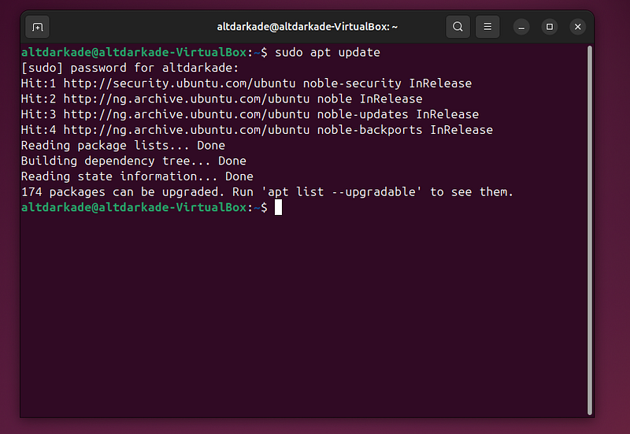

**2. Install Wazuh Using the Assistant Script**  
Run the following commands to download and execute the Wazuh installer:

```
curl -sO https://packages.wazuh.com/4.9/wazuh-install.sh && sudo bash ./wazuh-install.sh -a
```

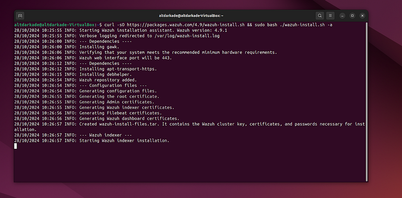

**3. Access the Wazuh Dashboard**  
Once the installation completes, copy the provided credentials from the terminal. Open your browser and navigate to `https://<your_server_ip>` to log in.

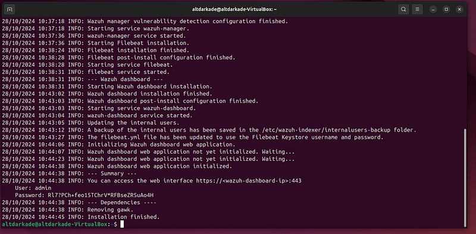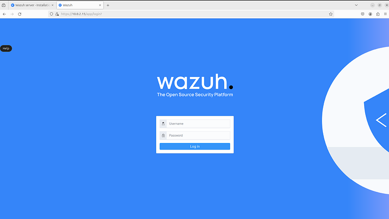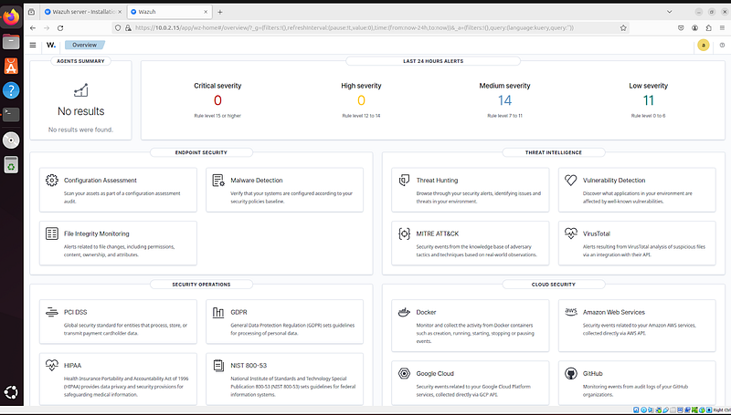

### Step 2: Installing Wazuh Agents

#### 2.1 Installing the Wazuh Agent on Windows

1. Open the Wazuh Dashboard and navigate to:  
   **Hamburger Icon > Server Management > Endpoint Summary**

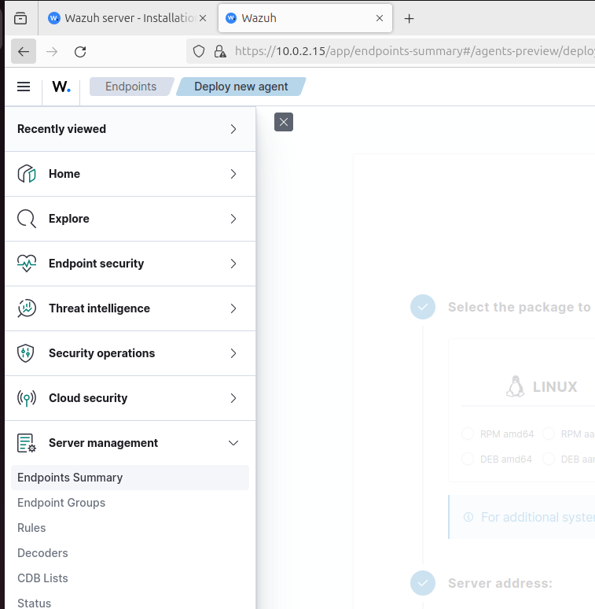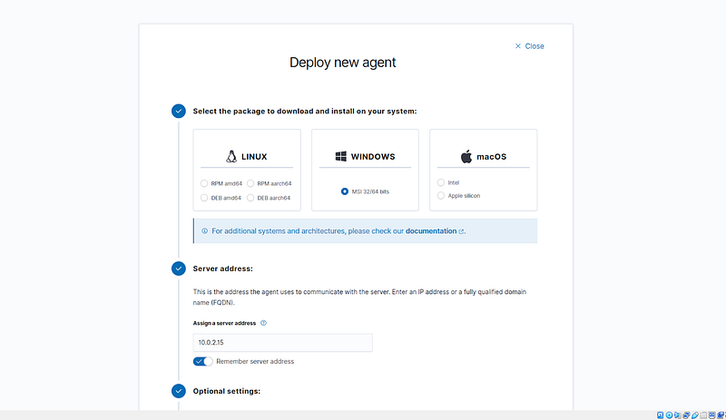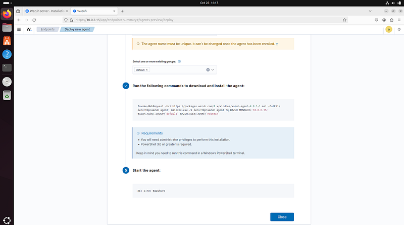

2. Download the **Windows Agent Installer**.

3. Open PowerShell as an administrator and execute the command below, replacing placeholders with actual values:

```
Invoke-WebRequest -Uri https://packages.wazuh.com/4.x/windows/wazuh-agent-4.9.1-1.msi -OutFile $env:tmp\wazuh-agent; msiexec.exe /i $env:tmp\wazuh-agent /q WAZUH_MANAGER='<Wazuh_Manager_IP>' WAZUH_AGENT_GROUP='default' WAZUH_AGENT_NAME='<Agent_Name>'
```

WAZUH\_MANAGER: Set this to your Wazuh Manager’s IP address or hostname.

WAZUH\_AGENT\_GROUP: Set this to the agent group you want (default is ‘default’).

WAZUH\_AGENT\_NAME: Customize the name for this agent (replace ‘HostWin’ with a unique name for the endpoint).

4. Start the Wazuh Agent service:

```
NET START WazuhSvc
```

5. Verify the connection in the **Agents > Manage Agents** section of the Wazuh Dashboard.

### Step 3: Monitoring Logs in Wazuh

#### 3.1 Configuring Local Log Monitoring

Edit the **ossec.conf** file to specify which logs you want to monitor. The location of this file depends on the operating system:

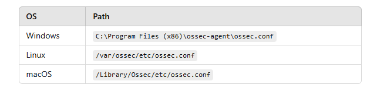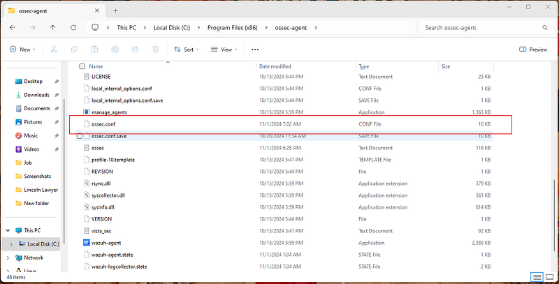

Specify event types and IDs to monitor. For example:

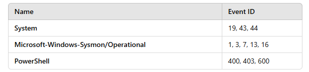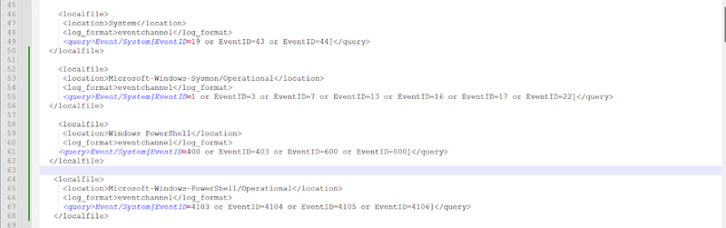

After editing, restart the Wazuh Agent:

```
NET STOP WazuhSvc  
NET 
START
 WazuhSvc
```

Or do it manually from the window services,

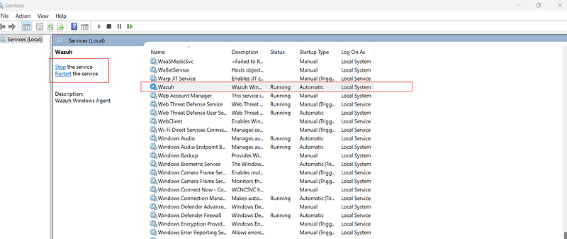

Confirm the changes in the Wazuh Dashboard.

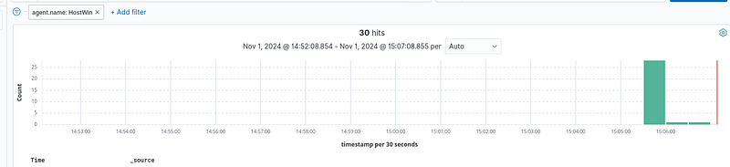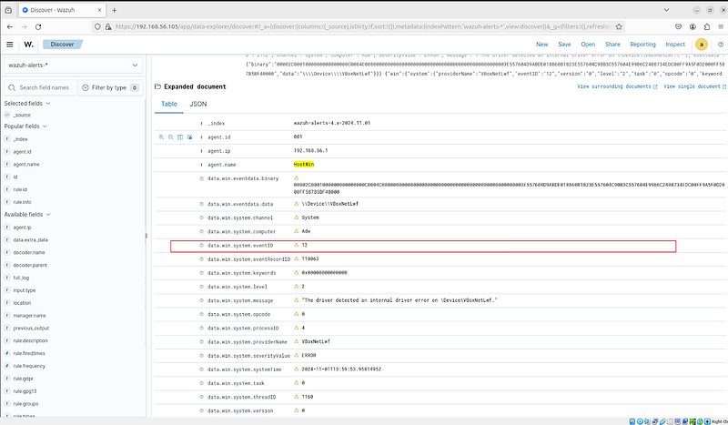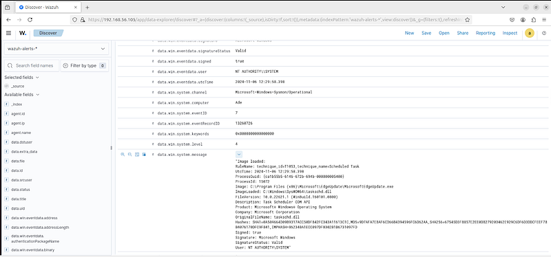

#### 4.2 Forwarding Windows Event Logs

1. Navigate to the Wazuh Dashboard > **Active Endpoint** section.

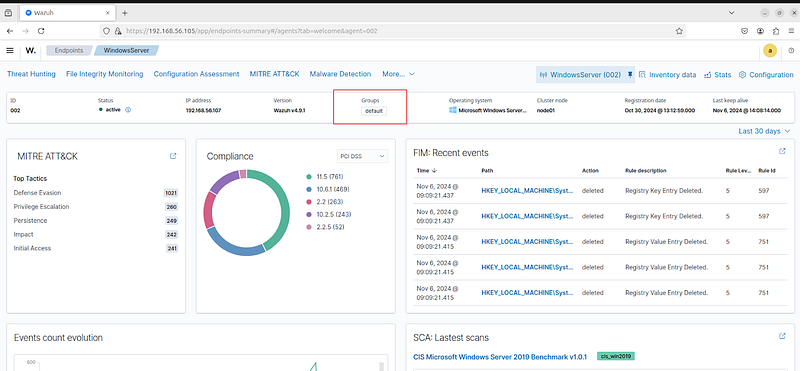

2. Select the desired endpoint and modify its **agent.conf** file.

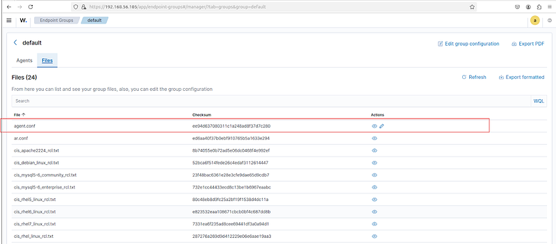

3. Add log paths for Windows Defender, PowerShell, Sysmon, or other logs.

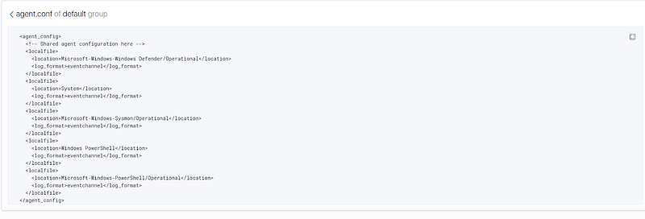

#### 4.3 Testing Log Collection with Windows Defender

To test the configuration, simulate an event by running a reverse PowerShell command. Windows Defender should block the execution, triggering an event log entry.

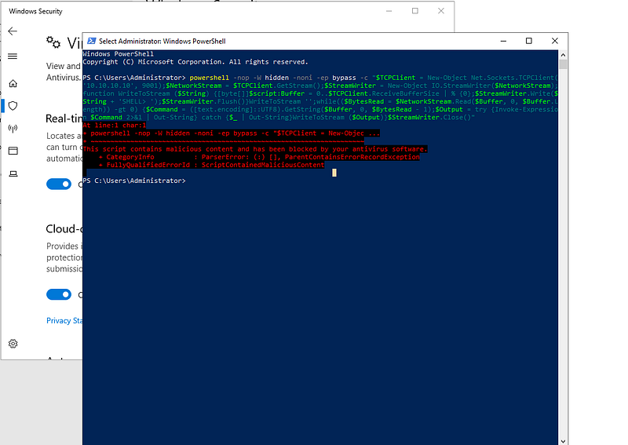

Check the Wazuh Dashboard to verify that the event was logged successfully.

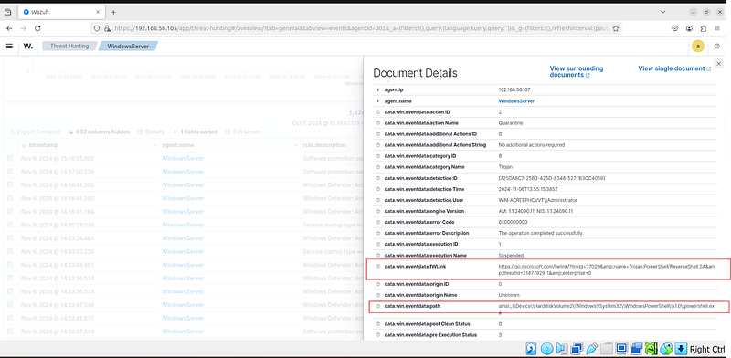

This process verifies that Wazuh is accurately collecting the specified Windows Event Logs from your endpoint.

### Conclusion

Wazuh is a powerful open-source platform that provides organizations with the tools to monitor and secure their environments. By following this guide, you’ve deployed a Wazuh server, installed agents on endpoints, and configured targeted log monitoring for enhanced security awareness.

Keep exploring Wazuh’s advanced features to ensure your systems stay secure in an ever-changing threat landscape!

#CyberSecurity #Wazuh #OpenSource #ThreatDetection #SIEM #Monitoring #Windows #Ubuntu
